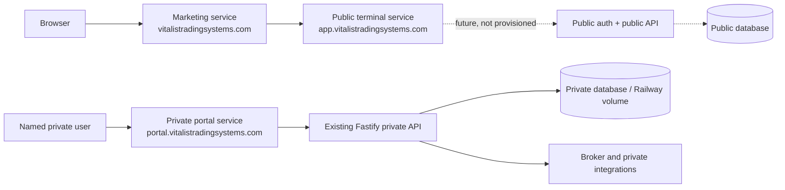

# Public and private application separation

Status: **scaffolded, not deployed, physical data/auth separation incomplete**.

## Before this change

One npm monorepo produced one Railway deployment:

- `apps/web` built the Terminal, including public demo/early-access entry points and all private partner, admin, broker, execution and employee functionality.
- `apps/api/src/server.ts` registered public, customer, partner, administration, broker and execution routes in one Fastify process.
- `apps/api/src/db/index.ts` opened one SQLite/libSQL database.
- `apps/api/src/auth/sessions.ts` used one `vts_session` cookie and one signing secret.
- `railway.json` built and served the combined API and web bundle.

A role check hid or denied individual features, but the production artifact and deployment boundary were shared.

## Architecture after this change

Three independent build targets now exist:

- `apps/marketing`: public static marketing build. Its only application link targets the public terminal. The destination is baked into the artifact from the required build-time `PUBLIC_APP_ORIGIN`; the build fails closed when it is absent or is not the exact public production origin or a canonical single-label Railway staging origin.
- `apps/public-terminal`: isolated customer shell. It imports no private source and deliberately exposes no login or data feature until separate public auth/API/database infrastructure exists.
- `apps/web` + `apps/api`: the existing application, now classified as the private portal and private API.

Railway service configurations are under `deploy/railway/`. The root `railway.json` continues to describe the private service so merging this branch cannot accidentally turn the existing service into a public deployment.

## Trust boundaries

### Public marketing

May deliver only marketing HTML, CSS and neutral brand assets. It must not contain a portal hostname, private routes, private feature names, private API configuration or private credentials.

### Public terminal

May eventually contain customer-approved features. Today it is a holding shell with no authentication, API or database. Its build has no dependency on `apps/web`, `apps/api`, trading execution, groups, partner feeds or administration.

### Private portal

Contains all existing Terminal behavior. It uses server-side authentication and RBAC, a production private-user ID allowlist, a private cookie name, explicit private origin configuration and a private database configuration name. Sensitive trading, partner and administration modules are:

> **INTERNAL ONLY — PENDING LEGAL AND COMPLIANCE REVIEW**

### Infrastructure

The three Railway services, two authentication systems and two physical databases are separate trust boundaries. This repository cannot create or prove those physical resources. Until the manual steps in `docs/deployment/subdomains.md` are complete, the split is not production-complete.

## Authentication separation

The existing private portal keeps the custom username/password session system:

- Private admission is enforced by stable internal user IDs from `PRIVATE_ACCESS_USER_IDS`.
- Production refuses to boot without an explicit allowlist.
- The production cookie defaults to `__Host-vts_portal_session`.
- Cookies are signed, `HttpOnly`, `SameSite=Lax`, `Path=/`, host-only and forced `Secure` in production.
- Session resolution re-checks the allowlist on every request, so removing an ID denies existing sessions.
- Public demo login and public early-access submission are no longer registered in the private portal.

The public terminal does not yet accept any identity or session. A future public auth service must use `PUBLIC_SESSION_SECRET`, `__Host-vts_public_session`, a distinct user store and, if OIDC is introduced, a distinct client and audience. Private cookies are host-only and therefore are not sent to the public hostname.

Private MFA is not implemented by the current custom auth stack. MFA is a deployment blocker, not something this change claims to provide.

## Database separation

The private API now prefers `PRIVATE_DATABASE_URL`; `DATABASE_URL` remains a compatibility fallback for development and the existing verification tools. The public terminal has no database client and no API.

Production completion requires a separately provisioned public database before customer data is introduced. No production records were moved, copied or deleted. No cross-database synchronization is defined.

## Origin and browser controls

- Private CORS resolves from `PRIVATE_PORTAL_ORIGIN`.
- Credentialed wildcard CORS is not used.
- Private responses set `X-Robots-Tag: noindex, nofollow`, `X-Content-Type-Options: nosniff`, `X-Frame-Options: DENY`, a `frame-ancestors 'none'` policy, `Referrer-Policy: no-referrer`, and a restrictive permissions policy.
- `apps/web/public/robots.txt` denies all crawlers.
- Public static services set `nosniff`, a strict referrer policy and a restrictive permissions policy.

The existing private API has no general CSRF-token middleware or global rate limiter. SameSite cookies help but are not a complete substitute. These remain security work before production separation can be called complete.

## Dependency enforcement

`scripts/verify-public-boundary.mjs` builds both public artifacts and fails when their source or output contains:

- a portal hostname;
- imports/references to the private web or API applications;
- partner/group/copy/mirror trading identifiers;
- order-placement or position-closing identifiers;
- private-signal identifiers.

The check also requires the marketing link to target the public application and requires the private crawler deny rule. It runs inside `npm run verify` and GitHub Actions.

## Known limitations

- No public customer feature, public API, public auth provider or public database exists yet.
- No physical Railway service, domain, TLS certificate or database was provisioned.
- The private production database has not been moved to a newly named resource.
- Private MFA, general CSRF tokens, global rate limiting and login brute-force controls remain incomplete.
- Neutral shared packages have not been extracted; the public applications intentionally share nothing with private code yet.
- Existing broker/order modules remain private but still require separate legal, compliance and vendor review.
