# Vitalis Trading Systems — Data & Integration Map

**Review date:** 2026-08-22 (UTC)
**Repository:** `andrewr92896-ship-it/vts-terminal` @ `97cf53d54afc7f2bd8eba8080b493f040a337f40` (branch `claude/vitalis-compliance-audit-47ww71`; `origin/main` @ `2402a37`)
**Method:** static inspection plus one local production build of the web app. No production system was contacted.

Every claim below cites `path:line`. Where a claim is an inference it is labelled **[INFERENCE]** with the evidence and what would confirm it.

---

## 1. Deployment topology (confirmed)

There is **one deployable unit**. `railway.json:1-13` builds the monorepo and starts `npm run start`, which is `apps/api`. In production that single Fastify process serves the API **and** both built web entries from `apps/web/dist` (`apps/api/src/server.ts:69,146-149`). There is no separate marketing site, no separate customer app, no separate partner app, and no separate database in this workspace.

```mermaid
flowchart TB
  subgraph PUB["PUBLIC INTERNET — one origin, one process"]
    direction TB
    ANON["Anonymous visitor"]
    CUST["Signed-in member<br/>(vts_session cookie)"]
    PART["Founder / software_developer<br/>+ Trading Teams grant"]
    STAFF["Employee<br/>(employee role + company email)"]
  end

  subgraph PROC["Railway service — Fastify (apps/api) — server.ts"]
    direction TB
    STATIC["@fastify/static → apps/web/dist<br/>index.html (main SPA, 964 kB)<br/>employee.html (separate entry)"]
    API["/api/* — 396 routes<br/>11 unauthenticated"]
    EAPI["/api/employee/* — separate session,<br/>2FA, CSRF, strict CSP, IP allowlist"]
    WATCH["Background watches:<br/>desk 10s · session 30s · rollover 30s<br/>founder-trade 30s · price-alert 20s<br/>notes 5m · feeds 5m · youtube 5m"]
  end

  DB[("SQLite / libsql — ONE file<br/>102 tables<br/>customer + partner + employee + audit")]

  subgraph EXT["External services"]
    OANDA["OANDA v20 REST<br/>api-fxtrade / api-fxpractice<br/>READ + ORDER"]
    KRK["Kraken Spot REST<br/>api.kraken.com<br/>READ + ORDER (spot only)"]
    ANTH["Anthropic API<br/>text + vision"]
    FRED["FRED (st. louis fed)"]
    FIN["Finnhub"]
    TV["TradingView<br/>free embed widgets (browser)"]
    TVW["TradingView webhook → VTS<br/>inbound, shared secret"]
    YT["YouTube (embed + Data API)"]
    PO["Pushover"]
    WP["Web Push / VAPID"]
    MAIL["Resend (HTTPS) or SMTP"]
    RSS["RSS: Reuters, AP, CNBC, Dow Jones,<br/>CoinDesk, Cointelegraph, FXStreet,<br/>federalreserve.gov, faireconomy.media,<br/>truthsocial.com, rsshub.app"]
    CB["api.coinbase.com (keyless crypto)"]
  end

  ANON -->|"POST /api/auth/demo<br/>POST /api/early-access"| API
  CUST --> STATIC
  CUST --> API
  PART --> API
  STAFF --> EAPI
  API --> DB
  EAPI --> DB
  WATCH --> DB
  API --> OANDA
  API --> KRK
  API --> ANTH
  API --> FRED
  API --> FIN
  API --> YT
  API --> PO
  API --> WP
  API --> MAIL
  API --> RSS
  API --> CB
  TVW --> API
  CUST -.->|"browser loads script directly"| TV
  API -->|"bearer token, no cookie"| WIDGET["iOS Scriptable widget<br/>GET /api/widget/positions"]
```

### Trust boundaries — what is and is not separated

| Boundary | Separated? | Evidence |
|---|---|---|
| Marketing site vs app | **Not present in this repo.** No landing page, pricing page, robots.txt or sitemap. `index.html` is `noindex,nofollow`. | `apps/web/index.html:6`; `apps/web/public/` contains only icons, `push-sw.js`, `sounds/`, `brand/` |
| Public customer app vs private partner features | **NO — same bundle, same origin, same process.** Admin screens, the Developer Terminal, the founder-trade modal and the whole trade desk are **statically imported** into the public entry. | `apps/web/src/components/Portal.tsx:25,40-57,66-67`; built bundle `apps/web/dist/assets/main-*.js` contains `/api/founder-trades*` (8 paths), all 9 `trading/desk/*` paths, `/api/admin/users`, `/api/dev/preview`, `/api/chat/admin` |
| Employee Portal vs main app | **YES at the bundle and session layer.** Separate Vite entry, separate cookie, separate session table, own CSP/CSRF/2FA/lockout/IP-allowlist. The employee bundle contains **zero** trading or admin API paths. | `apps/api/src/server.ts:157-180`; `apps/api/src/employee/guard.ts:21-27,213-262`; `apps/web/vite.config.ts:17-29`; built `employee-*.js` — 0 matches for `founder-trades\|/api/trading/desk\|/api/admin/users` |
| Employee identity vs customer identity | **NO — the same `users` table, the same password hash.** Only the session is separate. | `apps/api/src/employee/sessions.ts:136`; `apps/api/src/db/schema.ts:2543-2547` (`employee_sessions.user_id` → `users.id`) |
| Customer data vs partner data | **NO — one database, one set of tables.** Partner (founder-trade, private-group) rows sit in the same SQLite file as customer rows. | `apps/api/src/db/schema.ts` (102 tables, one file); `apps/api/src/config.ts:26` (`DATABASE_URL`, single default) |
| Production vs staging vs development | **Not evidenced.** One `railway.json`, one `DATABASE_URL`, no staging config, no environment matrix in CI. `.github/workflows/verify.yml` runs `npm run verify` only. | `railway.json`; `.github/workflows/verify.yml` |
| Vitalis Wealth Management | **No live code or tables.** Two dead handler branches remain in the demo guard, and a stale `HANDOFF.md` describes a shared-database RIA portal. | `apps/api/src/demo/demo.ts:63-64,117-118`; `HANDOFF.md:32-34,88-96` |

**Consequence, stated plainly:** the public/private separation in this system is **server-side authorization only**. It is not a build boundary, not an origin boundary, not a data boundary, and not a deployment boundary — with the single exception of `/employee`, which is genuinely separated at the bundle and session layer.

The server-side authorization itself is, on inspection, applied consistently: of 396 routes, 385 carry a `preHandler` guard, and the 11 that do not each perform their own check in the handler (see §5).

---

## 2. Broker integrations

### 2.1 OANDA — read **and** write

| File | Role | Endpoints |
|---|---|---|
| `apps/api/src/trading/brokers/oanda.ts` | **read only** | `GET /v3/accounts/{id}/openTrades` (`:443`), `/trades?state=CLOSED&count=500` (`:141`), `/summary` (`:211,263,478`), `/transactions` (`:219`), `/pricing` (`:335,474`), `/instruments` (`:433`), `/v3/instruments/{sym}/candles` (`:410`) |
| `apps/api/src/trading/brokers/oandaOrders.ts` | **WRITE — can move money** | `POST /v3/accounts/{id}/orders` (`:246-247`) · `PUT .../trades/{id}/close` (`:303-304`) · `PUT .../trades/{id}/orders` — set/clear TP/SL (`:356-357`) · `PUT .../orders/{id}/cancel` (`:404-405`) · `GET .../pendingOrders` (`:385`) · `GET .../instruments` (`:430`) · `GET .../pricing` (`:490`) |

- **Auth:** personal access token, `Authorization: Bearer` (`oandaOrders.ts:111-120`).
- **Environment:** `api-fxtrade.oanda.com` (live) or `api-fxpractice.oanda.com` (practice), selected per connection from the stored credential's `env` field and per install from `OANDA_ENV` (`trading/config.ts:54-59,79-84`). **A live host is fully supported.**
- **Permission model:** OANDA personal access tokens are **not granular**. A token that can read positions can also place orders. There is no read-only variant to fall back on. `[INFERENCE — from OANDA's documented token model plus the absence of any scope parameter in this codebase; confirm with OANDA in writing.]`
- **Subaccounts:** one `accountId` per connection (`trading/config.ts:33-38`), so a token covering several subaccounts is exercised against only the one named.
- **Order safety handling that is genuinely implemented:** OANDA answers `201 Created` even when it immediately cancels the order, so an `orderCancelTransaction` in the body is raised as an error rather than reported as a fill (`oandaOrders.ts:246-282`).

### 2.2 Kraken — read **and** write, spot only

| File | Role | Endpoints |
|---|---|---|
| `apps/api/src/trading/brokers/krakenClient.ts` | shared transport | HMAC-SHA512 signing (`:52-60`), monotonic per-process nonce (`:42-50`), error-array-before-status decoding (`:73,130-165`) |
| `apps/api/src/trading/brokers/kraken.ts` | **read only** | margin `OpenPositions` (`:84`) |
| `apps/api/src/trading/brokers/krakenOrders.ts` | **WRITE — can move money** | `AddOrder` (`:332`) · `CancelOrder` (`:402`) · `OpenOrders` (`:375`) · `QueryOrders` (`:299`) · `Balance`/`BalanceEx` (`:258,268`) · `TradeBalance` (`:242`) · public `AssetPairs`/`Ticker` (`:156,202`) |

- **Spot-only is a real property, not a claim.** No request built in `krakenOrders.ts` ever sends `leverage` (`:315-322`, comment at `:321`). Consequence: no short, no liquidation path, and the API key needs Query funds + Query open orders & trades + Create & modify orders and **not** margin trading.
- **Refusal handling:** Kraken answers HTTP 200 to a refusal with the reason in an `error` array, checked before the status in one place (`krakenClient.ts:130-165`); `AddOrder` returns a transaction id rather than a fill, so `placeKrakenOrder` re-reads `QueryOrders` before reporting anything (`krakenOrders.ts:341-362`).

### 2.3 Other broker keys referenced but not wired

`BROKER_META` lists TradeStation and Funded Trading Plus (`trading/config.ts:15-21`) and `.env.example` documents `TRADESTATION_*` and `FTP_*`. **No connector file exists for either** — `find` over `apps/api/src` returns only `oanda*`, `kraken*`, `fred.ts` and `crypto.ts`. FTP/Match-Trader data reaches the terminal only by the AI screenshot import (`ai/claude.ts:239-300`).

### 2.4 The one endpoint that can trade with no session

None. **Every** order path is behind `requireWorkspaceWrite('trading')` + `requirePremium('tradeDesk')` (`routes/tradeDesk.ts:97-98`) or `requireFounder` (`routes/founderTrades.ts:89`), plus the demo refused twice (`demoGuard` on every non-GET, and `refuseDemo` inside the service at `trading/orderDesk.ts:115,446,597,661,747`).

---

## 3. Credential and secret inventory

**No secret VALUE appears in this report, and none was found committed.** `.gitignore` excludes `.env`/`.env.*` (`.gitignore:11-13`); `git ls-files` shows only `.env.example`; a pattern scan for AWS keys, private-key PEM blocks, GitHub tokens, Slack tokens and Anthropic keys across `apps/`, `scripts/` and the markdown files returned nothing.

### 3.1 Customer-supplied credentials (the real custody exposure)

| Credential | Where entered | Storage | Reaches the browser? | Evidence |
|---|---|---|---|---|
| OANDA personal access token | Live Brokers panel, main app | `broker_connections.credentials`, AES-256-GCM, envelope `v2:<keyId>:<iv>:<tag>:<ct>`, HKDF-SHA256 key, AAD binds the ciphertext to `(userId, connectionId)` | **No.** `toPublic()` returns id, broker, label, summary, env, active, status, timestamps — no credential field | `trading/connections.ts:212-227,453-560`; `security/secretbox.ts:1-60` |
| Kraken API key + private key | same | same | No | same |
| **OANDA account id** | derived from the token | **`broker_connections.summary`, PLAINTEXT** (`"Live · 001-001-1234567-001"`) | **Yes** — to the owner, and to any admin via `GET /api/trading/connections/all` | `trading/connections.ts:155-163,247-255` |
| Pushover user key | Alert Settings | `pushover_users` | not re-served | `apps/api/src/routes/pushover.ts` |
| Employee sign-in password | `/employee` | shared `users.password_hash`, argon2id (19 MiB, t=2, p=1) | No | `auth/passwords.ts:5-9` |

### 3.2 Server-side secrets (environment only — all redacted, none committed)

| Variable | Purpose | Required? | Evidence |
|---|---|---|---|
| `SESSION_SECRET` | signs the session cookie | **required in production**, ≥16 chars; dev falls back to a published literal | `config.ts:27,186-190`; `security/credentialsKey.ts:25` |
| `CREDENTIALS_KEY` | encrypts every broker credential | **required in production**, must be ≥32 bytes of generated randomness (base64/hex), must differ from `SESSION_SECRET`; the process exits at boot otherwise | `config.ts:72,197-222`; `security/credentialsKey.ts:160` |
| `ANTHROPIC_API_KEY` | all AI | optional (AI returns 503 when unset) | `config.ts:36`; `ai/claude.ts:9-16` |
| `TRADINGVIEW_WEBHOOK_SECRET` | inbound webhook | optional (webhook 503s when unset) | `config.ts:57`; `routes/webhooks.ts:21-24` |
| `OANDA_API_TOKEN` / `OANDA_ACCOUNT_ID` / `OANDA_ENV` | install-level OANDA account | optional, read via `process.env` outside the Zod schema | `trading/config.ts:50-60` |
| `OANDA_PRICING_TOKEN` / `_ACCOUNT_ID` / `_ENV` | the pricing account for Market Data and the price-alert watch | optional; **falls back to the general `OANDA_*` account** | `trading/config.ts:75-87` |
| `KRAKEN_API_KEY` / `KRAKEN_API_SECRET` | install-level Kraken | optional | `trading/config.ts:89-95` |
| `FRED_API_KEY`, `FINNHUB_API_KEY`, `YOUTUBE_API_KEY` | market data / news | optional | `config.ts:88,96`; `trading/feeds.ts:65`; `investments/prices.ts:67,122` |
| `VAPID_PUBLIC_KEY` / `VAPID_PRIVATE_KEY`, `PUSHOVER_APP_TOKEN` | notifications | optional | `config.ts:77-78,102` |
| `RESEND_API_KEY`, `SMTP_USER`/`SMTP_PASS` | employee sign-in codes | optional; with neither, the code is written to the server log | `config.ts:123-145`; `employee/mailer.ts` |
| `EMPLOYEE_IP_ALLOWLIST` | network fence on `/employee` | optional; **fails closed** when set | `config.ts:180`; `employee/network.ts` |
| `ADMIN_USERNAME` / `ADMIN_PASSWORD` / `ADMIN_EMAIL` | first-boot seed | read via `process.env`, outside the schema; blank password → random, printed once to logs | `seed.ts:91-119` |

**Documented-but-absent:** `TV_WEBHOOK_SECRET` appears in AGENTS.md as a live variable guarding a second webhook. It is **not in the config schema** and there is no route that reads it (see §6).

### 3.3 Key handling notes

- The credentials key is **memoized per process** and derived by HKDF, deliberately not a slow KDF, because credentials are decrypted on a 10-second poll for every connection on a team (`security/secretbox.ts:11-16`).
- A `keyId` travels with each ciphertext, which is the seam a rotation path would use. **Rotation is not built** (`security/secretbox.ts:38-47`).
- `PRAGMA secure_delete = ON` is set so a deleted row's ciphertext is overwritten (`db/index.ts`). Already-freed pages keep their contents until a `VACUUM`, which is not run.
- Foreign keys are **never enabled** on this database, so every declared `ON DELETE` is documentation rather than behaviour; cleanup is explicit in `admin/service.ts` (`db/index.ts`).

---

## 4. Data-class inventory

`user_id`-scoped unless noted. "Deleted with the account" means it appears in the `deleteUser` transaction at `apps/api/src/admin/service.ts:490-700`.

| Data class | Stored in | Encrypted at rest | Who can read it | Deleted with the account | Crosses to a third party |
|---|---|---|---|---|---|
| Name, username, display name, email | `users` | no | self; any admin (`GET /api/admin/users`); teammates see username + display name only | yes | no |
| Password hash | `users.password_hash` | argon2id | nobody (never in a payload) | yes | no |
| Session tokens | `sessions` (SHA-256 of the token) | hashed | — | yes | no |
| **Broker API credentials** | `broker_connections.credentials` | **AES-256-GCM, row-bound** | nobody — decrypted only in `getActiveDecrypted` | yes | sent to OANDA/Kraken as auth |
| **Broker account identifiers** | `broker_connections.summary` | **plaintext** | self + all admins | yes | no |
| Open positions, entry/exit, size, stop, target, P/L | `trading_positions`, `manual_positions`, `funded_trades` | no | self; **teammates when the viewer holds the Trading Teams grant**; all admins for support | yes | screenshots go to Anthropic |
| Account balance / NAV / equity / margin | live from the broker + `trading_challenges`, `trading_capital_accounts` | no | self; desk leads for capital; admins | yes | balance/equity screenshots go to Anthropic |
| Deposited / withdrawn capital | `trading_capital_accounts` | no | self; a desk lead may set a member's | yes | no |
| Investment holdings, transactions, goals | `investment_*` | no | **self only** — `scopedTraderIds` does not appear in this workspace | yes | symbols go to Finnhub/coin feed for quotes |
| Net worth items and history | `net_worth_items`, `net_worth_snapshots` | no | self only | yes | no |
| Budget categories and entries | `budget_categories`, `budget_entries` | no | self only | yes | no |
| **Forward-looking directional calls** | `trading_notes` | no | self; the private group once the window opens | yes | instrument sent to the pricing account |
| Trade-coordination workflow + funded-leg screenshots | `founder_trade_invites` (inline JPEG data URL), `founder_trade_events` | no | **the two parties only** — a non-party id answers 404 | yes | no |
| Group chat messages | `chat_messages` | no | group members; admins can delete | yes (authored rows) | no |
| AI conversations | **not stored**, except those that trip the advice guardrails → `ai_violations` | no | admins (Rule Breaking screen) | yes | every prompt goes to Anthropic |
| AI usage counters | `ai_usage` (nullable `user_id` for background jobs) | no | self; admins see the system total | yes | no |
| Support / bug-report conversations | `support_requests`, `bug_reports` + message tables | no | self + admins | yes | intake text goes to Anthropic |
| Push endpoints / Pushover user key | `push_subscriptions`, `pushover_users` | no | — | yes | endpoints go to the push service |
| **Credential-use audit (incl. request IP)** | `credential_audit` | no | self (own rows) + all admins | **NO — deliberately survives deletion** | no |
| **Employee audit log** | `employee_audit_log` | no | self + portal admins | **NO — deliberately survives deletion** | no |
| Employee headshots | `users.avatar` (400 px JPEG data URL) | no | all employees in the directory | yes | no |
| Study content and progress | `study_*` | no | self; group; the public library when published | yes (owned packages purged) | study text goes to Anthropic when generated |
| Early-access leads (name, email, message) | `early_access_requests` | no | admins | n/a (not tied to an account) | no |

### Data leaving the system

| Destination | What goes | Trigger | Evidence |
|---|---|---|---|
| **Anthropic** | free-text chat; **screenshots of broker and prop-firm dashboards** (balances, positions, account identifiers); funded-challenge metrics; support/bug text; headlines; study content | user action, plus two background jobs (news tagging — default OFF; calendar explainer — default ON) | `ai/claude.ts:108,188,244,319,363,539`; `trading/feeds.ts:300,317` |
| OANDA / Kraken | the user's own credential + order instructions | Live Wall poll, desk watch, backfill, order placement | `trading/connections.ts`; `trading/brokers/*` |
| Finnhub | equity/ETF symbols | Investments pricing, news poll | `investments/prices.ts:122`; `trading/feeds.ts:65` |
| FRED | series ids only | Market Data macro | `trading/brokers/fred.ts` |
| YouTube | channel ids/handles | stream wall | `trading/youtube.ts` |
| Pushover | notification title + body (which can contain instrument, side and price) | trade events, alerts, group nudge | `notifications/*` |
| Web Push service | notification payload | same | `push/*` |
| Resend or SMTP | employee sign-in codes | employee login | `employee/mailer.ts` |
| **TradingView (browser-side)** | the viewer's IP, user agent and referrer, from `s3.tradingview.com` script tags | any Live Wall chart/watchlist tile | `apps/web/src/workspaces/trading/ChartTile.tsx:28`; `WatchlistTile.tsx:19-20` |

**No data-processing agreement, vendor contract, licence file or attribution document exists anywhere in this repository** (`find` for `LICENSE*`, `*agreement*`, `*.pdf` outside `node_modules` returns nothing).

---

## 5. The eleven unauthenticated endpoints

| Route | What protects it | Concern |
|---|---|---|
| `GET /api/health` (`routes/health.ts:5`) | nothing | none |
| `POST /api/auth/login` (`routes/auth.ts:105`) | password only | **no rate limit, no lockout, no CAPTCHA, no MFA** on the main terminal |
| `POST /api/auth/demo` (`routes/auth.ts:149`) | nothing — signs the visitor into the demo | by design |
| `POST /api/auth/logout` (`routes/auth.ts:173`) | nothing | none |
| `POST /api/early-access` (`routes/earlyAccess.ts:23`) | nothing | no CAPTCHA or rate limit on a public write |
| `POST /api/webhooks/tradingview` (`routes/webhooks.ts:20`) | shared secret in body or `?secret=` | compared with `!==` at `:49` — **not a constant-time comparison** |
| `POST /api/pushover/callback/:token` (`routes/pushover.ts:184`) | unguessable path token; answers 200 unconditionally | acceptable by design |
| `GET /api/widget/positions` (`routes/widget.ts:59`) | bearer token, SHA-256 stored | **token never expires**, is accepted in `?token=`, and the resolve path re-checks only `users.active` — not the Advanced Trading opt-in, membership or demo status (`trading/widgetToken.ts:65-74`) |
| `GET /api/employee/session` (`routes/employee.ts:274`) | reads the employee cookie | by design |
| `POST /api/employee/login` (`routes/employee.ts:295`) | password + progressive lockout + emailed 2FA code | properly defended |
| `POST /api/employee/logout` (`routes/employee.ts:454`) | nothing | none |

---

## 6. Confirmed documentation-vs-implementation discrepancies

| Claim in `AGENTS.md` | Reality | Evidence |
|---|---|---|
| "TradingView webhooks — **TWO endpoints**… `POST /api/tv-webhook` — secret `TV_WEBHOOK_SECRET` (body-only, timing-safe). Writes a different table `tv_alerts`." | The route does not exist, `TV_WEBHOOK_SECRET` is not in the config schema, and `tv_alerts` was dropped. | `apps/api/migrations/0064_drop_tv_alerts.sql:1`; no match for `tv-webhook` in `apps/api/src`; `config.ts` has no such key |
| "`canAccessWorkspace(roles, ws, features)`'s **third argument is required, and must stay required**." | The function takes **two** arguments and unconditionally returns `true`. Opt-in enforcement was moved into the middleware. | `auth/rbac.ts:137-139`; `auth/middleware.ts:115-121` |
| Login is "constant-time-ish (always runs a verify) to resist enumeration" — restated in the code comment itself. | `!!user && user.active && (await verifyPassword(...))` short-circuits, so `verifyPassword` is **not** called when the account is missing. The comment sits directly above the code that contradicts it. | `routes/auth.ts:126-131` |
| Terms and Privacy describe the product as "**read-only**". | The terminal places, closes, amends and cancels real orders at two venues. | `apps/web/src/legal/content.ts:84,87,364,372,379,567,593-595,959` vs `trading/brokers/oandaOrders.ts:218,294,332,403` |
| `/api/wealth/overview/brief`, `/api/finance/overview/brief` | Handled in the demo guard; **no such routes exist**. | `demo/demo.ts:117-118` |
