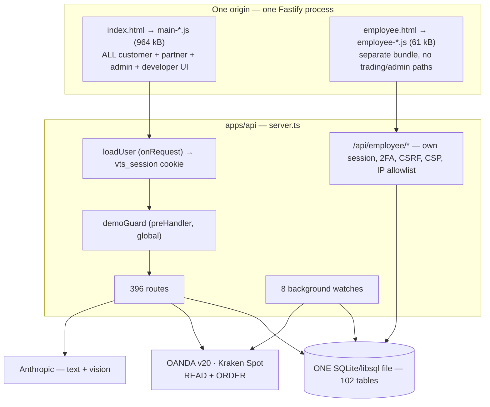

# Vitalis Trading Systems — Technical Discovery Handoff

**Prepared for:** a fresh compliance-risk audit, and for review by a U.S. securities / commodities / fintech attorney.
**Nature of this document:** factual technical findings only. It states what the code does. It reaches **no legal conclusion** about whether anything is legal, illegal, registered, exempt, compliant or noncompliant.

---

## 1. Review scope, method and limitations

| | |
|---|---|
| **Review date/time** | 2026-08-22, 22:08–23:0x UTC |
| **Working directory** | `/home/user/vts-terminal` |
| **Repository** | `andrewr92896-ship-it/vts-terminal` (renamed from `vts-portal`) |
| **Commit reviewed** | `97cf53d54afc7f2bd8eba8080b493f040a337f40` — *"Study games: the handoff could not be finished (#429)"* |
| **Branch** | `claude/vitalis-compliance-audit-47ww71`; `origin/main` @ `2402a37` (#426) — the branch is 3 commits ahead of main |
| **Working tree** | clean (`git status --porcelain` empty) before this review; only `docs/compliance-discovery/` and build artefacts were added |
| **Structure** | one npm-workspaces **monorepo**: `apps/api` (Fastify + TypeScript) and `apps/web` (Vite + React 18) |
| **Scale** | 396 HTTP routes · 102 database tables · 134 SQL migrations · one 964 kB public JS bundle |

### Scope limitations — read these before trusting any absence claim

1. **The clone is SHALLOW (50 commits).** `.git/shallow` exists; `git log` returns exactly 50 commits, the oldest being #381. The repo's own PR numbers reach #429, so **roughly 380 commits of history are unavailable.** Any question of the form "was this feature ever different / ever public / ever removed" **cannot be answered** from this workspace. Deleted-code and secret-in-history scans are impossible.
2. **Only one repository is present.** No marketing-site repo, no iOS/Capacitor shell, no infrastructure-as-code, no separate partner or wealth-management repo. If `vitalistradingsystems.com` is served from anywhere, it is not here. Nothing was fetched or cloned.
3. **No production system was contacted.** No broker API call, no webhook fired, no notification sent, no database touched, no deploy, no commit, no push. All broker/AI/vendor behaviour below is from static inspection.
4. **No runtime configuration was available.** No `.env`, no Railway variables, no database file. So: whether OANDA connections point at **live or practice** accounts, whether `ANTHROPIC_API_KEY`/`TRADINGVIEW_WEBHOOK_SECRET` are set, how many real users exist, and what tier anyone holds are all **unknown**.
5. **No security tooling was installed or run.** Findings come from reading code, not from scanning or fuzzing. `npm install` and one local `vite build` were run (see §22); nothing else executed.

---

## 2. Executive factual summary

- **This is one application, one process, one origin, one database.** Railway builds the monorepo and runs `apps/api`, which serves the API *and* the built React app (`railway.json:1-13`; `apps/api/src/server.ts:69,146-149`). There is no public/private split at the deployment, data, origin or build layer — with one genuine exception, the Employee Portal.
- **The terminal places real trades.** `POST /api/trading/desk/orders` sends live market/limit/stop orders to OANDA (margin FX/CFD) and Kraken (spot crypto), with close, amend-stop/target and cancel alongside. This is a **Level 5** surface.
- **There is a partner trade-copy workflow.** One founder-level user's *fill* automatically raises an invitation to another founder-level user, carrying instrument, direction and (by an install-wide setting) the inviter's stop and take profit. The recipient presses JOIN and the terminal places a real order on **their own** account at **their own** stored size. This is human-confirmed copying — **Level 5**.
- **The Terms of Service and Privacy Policy describe the product as "read-only."** They say so in at least nine places. This is the single largest documentation-vs-implementation contradiction found.
- **There is no billing of any kind.** No Stripe, no StoreKit, no PayPal, no trial, no cancellation, no refund path. The three-tier paywall exists and is enforced server-side, but tiers are granted by hand by an administrator.
- **There is no in-app account deletion and no data export.**
- **Server-side authorization is, on inspection, applied consistently and thoughtfully.** 385 of 396 routes carry an explicit `preHandler` guard; the other 11 check a secret or token inside the handler. The order path can only ever reach the caller's own broker connection. That is the strongest part of the system.
- **The weakest structural property is that none of the private functionality is separated from the public product by anything other than that authorization.** A local production build confirms the public bundle contains admin screens, the Developer Terminal, the founder-trade client and every trade-desk endpoint path.

---

## 3. Current architecture (confirmed)

**One deployable service.** `railway.json` → NIXPACKS → `npm install && npm run build` → `npm run start` → `apps/api`, health-checked at `/api/health`.

**Roles** (`apps/api/src/auth/rbac.ts:72-116`): `founder`, `software_developer` (permission-equivalent to founder), `admin`, `employee`, `member`. There are **four independent access axes**, and confusing them is the classic error here:

| Axis | Meaning | Where |
|---|---|---|
| **Role** | what you are trusted with | `users.roles` (JSON) |
| **Feature opt-in** | what you asked to see (Advanced Trading, Funded) | `user_features` |
| **Membership tier** | what you paid for (free / premium / max) | `user_memberships` — granted by hand |
| **Trading Teams grant** | hand-granted, not for sale; gates every group surface **and** shared trade visibility | `user_features.trading_teams` |

---

## 4. Public / private separation — the central finding

### 4.1 Answers to the fifteen separation questions

| # | Question | Answer | Evidence |
|---|---|---|---|
| 1 | Is separation based only on UI visibility? | **No — server-side authorization is real and consistently applied.** But it is *the only* boundary: not build, not origin, not data, not deployment. | `apps/api/src/auth/middleware.ts:36-257`; 385/396 routes guarded |
| 2 | Does the public app contain private feature code? | **YES.** Admin screens, Developer Terminal, founder-trade modal and the trade desk are **statically imported** into the public entry — not lazy-loaded. | `apps/web/src/components/Portal.tsx:25,40-57,66-67`; built `main-*.js` |
| 3 | Can a public user call a private API directly? | **They can reach it; they are refused.** Every private route has a `preHandler`. | `/tmp` route matrix; `routes/founderTrades.ts:89`; `routes/tradeDesk.ts:97-98` |
| 4 | Same database? | **YES — one SQLite file, 102 tables.** | `apps/api/src/config.ts:26`; `db/schema.ts` |
| 5 | Shared tables / customer records? | **YES.** Customer, partner, employee and audit rows are all in it. | same |
| 6 | Shared authentication sessions? | **Partly.** Two separate session tables and cookies, but **the same `users` table and password hash.** | `employee/sessions.ts:136`; `db/schema.ts:2543-2547` |
| 7 | Cookies scoped to the parent domain? | **No.** `path:'/'`, no `domain` attribute → host-only. Employee cookie is `__Host-`-prefixed in production. | `auth/sessions.ts:21-30`; `employee/sessions.ts` |
| 8 | Can a public role become a partner role via a client field? | **No.** `assertCanAssignRoles` — only the owner (matched on the immutable `createdUsername`) may grant founder/software_developer; the Trading Teams grant is refused by `setUserFeatures` entirely and has one writer. | `admin/service.ts:111`; `auth/rbac.ts:44`; `features/service.ts` |
| 9 | Does the public build contain internal route names / labels / API paths? | **YES.** In `main-*.js`: `/api/founder-trades` ×18, `/api/admin/users` ×6, `/api/dev/preview` ×2, `/api/chat/admin` ×3, all 9 `trading/desk/*` paths, and the strings "Founder" ×41, "Developer Terminal" ×9, "Administrator Log" ×6, "Rule Breaking" ×3. 225 distinct `/api/...` paths total. | built `apps/web/dist/assets/main-D2JRJ9QT.js` |
| 10 | Are internal URLs exposed elsewhere? | Only `/employee`, as a visible sidebar link shown when `canAccessEmployeePortal` holds. **No source maps are emitted.** | `apps/web/src/components/Sidebar.tsx`; `dist/assets/*.map` — none |
| 11 | Prod / staging / dev credentials separated? | **Cannot be determined** — no environment matrix in the repo. Only one `railway.json`, one `DATABASE_URL`. | `railway.json`; `config.ts:26` |
| 12 | Can dev/staging connect to live broker accounts? | **Yes, structurally.** `OANDA_ENV=live` is a plain env var and stored per connection; nothing ties the host to `NODE_ENV`. | `trading/config.ts:54-59` |
| 13 | Can the private portal reach public customer broker accounts? | **The Employee Portal cannot** — it has no trading routes at all. **An admin in the main app can**: list every connection (`GET /api/trading/connections/all`), rename, pause and remove them, and read the whole credential audit. They cannot decrypt or read a credential. | `trading/connections.ts:247-255,259-290`; `routes/trading.ts` |
| 14 | Can public code invoke private trade-sharing or execution services? | The **code is present** in the public bundle; the **endpoints refuse**. Founder-trade routes are `requireFounder` (reads included) and answer 404 on a non-party id so ids cannot be probed. | `routes/founderTrades.ts:89,229-236`; `trading/founderTrades.ts:980` |
| 15 | Does Vitalis Wealth Management share infrastructure? | **No live code or tables.** Two dead demo-guard branches (`/api/wealth/overview/brief`, `/api/finance/overview/brief`) and a stale `HANDOFF.md` describing an RIA portal in this same repo and DB. | `demo/demo.ts:63-64,117-118`; `HANDOFF.md:32-34,88-96` |

### 4.2 The one place separation is real

The **Employee Portal** is genuinely separated: its own Vite entry (`apps/web/vite.config.ts:17-29`), its own bundle (61 kB, containing **zero** matches for `founder-trades`, `/api/trading/desk` or `/api/admin/users`), its own cookie and session table, emailed-code 2FA, progressive lockout, a per-session CSRF token derived by HMAC and never stored, `Sec-Fetch-Site` origin checks, an optional fail-closed IP allowlist, a strict CSP, `no-store`, `noindex`, exclusion from the service-worker precache, and an append-only audit log (`apps/api/src/employee/guard.ts:21-27,54-102,213-262`; `apps/api/src/server.ts:157-180`).

**Notably, the main terminal has none of that.** No CSP, no HSTS, no `X-Frame-Options`, no helmet, no CSRF token, no login rate limit, no lockout, no MFA. A code comment states it outright: *"There is no Content-Security-Policy on the main app"* (`apps/web/src/workspaces/trading/TvWidget.tsx:10-12`).

---

## 5. Complete feature summary

See `FEATURE_INVENTORY.csv` (54 features) and `ENDPOINT_ACCESS_MATRIX.csv` (396 routes). Headline counts:

| Escalation level | Count | Examples |
|---|---|---|
| **Level 5** — execution / copying | 7 | Trade Desk place / close / amend / cancel; founder-trade invitation, JOIN, test drill; broker credential custody |
| **Level 4** — personalised trading output | 1 | funded-challenge AI coaching brief |
| **Level 3** — signals / social / performance | 10 | TradingView webhook fan-out; Trading Notes; Strategy Session bias; Live Wall team book; Trade Log win rate & profit factor; group chat; group nudge; demo sample P/L; funded proof screenshots; Private Groups |
| **Level 2** — read-only financial data | 8 | Live Wall self-only; widget positions; Investments; Net Worth; Market Data; capital cards; credential audit; screenshot import |
| **Level 0–1** | 21 | studies, budget, chat admin, patch notes, support, etc. |
| **Not implemented / dead / documented-only** | 7 | copy trading for general users; discretionary accounts; affiliate/revenue share; in-app deletion; marketing site; `/api/tv-webhook`; wealth-management remnants |

---

## 6. Level 2 → Level 5 findings, with exact behaviour

### 6.1 LEVEL 5 — Trade Desk order placement

**What it does.** `POST /api/trading/desk/orders` accepts `{connectionId, instrument, side, units, type: market|limit|stop, price?, takeProfit?, stopLoss?}` and sends a live order.

- Guard: `[requireWorkspaceWrite('trading'), requirePremium('tradeDesk')]` (`routes/tradeDesk.ts:98,165`). `tradeDesk` is the **Max** tier (`memberships/tiers.ts:93`).
- The demo is refused **twice** — by the global `demoGuard` on every non-GET (`demo/demo.ts:101-127`) and again inside the service (`trading/orderDesk.ts:115,446`).
- **The personal boundary is structural, not a check.** Every write resolves its connection through `getActiveDecrypted(userId, {only: connectionId})`, keyed on the caller, so **no code path reaches a teammate's account** (`trading/orderDesk.ts:47-62`, comment at `:29-42`).
- Sibling writes: close whole or partial (`:184`), amend stop/target — `PATCH /api/trading/desk/position` (`:196`) — and cancel a working order (`:209`).
- Real order-safety handling: identical entry tickets inside a **5-second window** are refused (`orderDesk.ts:65,381-412`); OANDA's `201 Created`-then-cancelled case is raised as an error; Kraken's HTTP-200 refusal is decoded before the status and `AddOrder`'s outcome re-read from `QueryOrders`.
- **Every attempt, including refusals, is journalled** to `trading_orders` (`orderDesk.ts:71-115`).
- **Kraken is spot-only as a structural property:** no request ever sends `leverage` (`brokers/krakenOrders.ts:315-322`). No short, no liquidation path.

**Evidence:** `apps/api/src/routes/tradeDesk.ts:97-98,101-221`; `apps/api/src/trading/orderDesk.ts:790-816`; `apps/api/src/trading/brokers/oandaOrders.ts:218,294,332,403`; `apps/api/src/trading/brokers/krakenOrders.ts:311,401`.

### 6.2 LEVEL 5 — Founder-to-founder trade coordination

This is the feature most likely to change a legal analysis, and it is recent (PRs #421, #422, #424, #425 — all in the 50 available commits).

1. **A fill raises an invitation, server-side, automatically.** `POST /api/trading/desk/orders` calls `autoInviteAfterFill(user, orderRecordId, status)` fire-and-forget (`routes/tradeDesk.ts:177`). It fans out over **standing links** (`founder_trade_links`, one row per direction between two founders), so no per-trade human decision is involved. Only a `status === 'filled'` order raises one (`trading/founderTrades.ts:885-923`).
2. **What travels is an install-wide setting, not the sender's choice**: instrument and direction always; the inviter's **stop** and **take-profit** each travel or not, both defaulting ON (`trading/founderTradeConfig.ts`; `trading/founderTrades.ts:1188-1195`). **The size deliberately never travels.**
3. **The recipient is notified with repeating Pushover alerts** that continue while the row still owes an action, bounded at 24 hours (`trading/founderTradeWatch.ts`).
4. **A blocking modal, mounted globally in `Portal.tsx`, presents the trade** — direction and instrument set large, the facts restated on each step, the size the order will go out at stated before the button, no close button, no Escape handler (`apps/web/src/components/FounderTradeModal.tsx`).
5. **JOIN places a real order.** `joinPrimary` requires the Advanced Trading opt-in, requires a stored `default_units` (an unset one is **refused, never defaulted**), requires a chosen own connection, takes a conditional-UPDATE claim so a double-click cannot become two positions, drops the target on a spot venue that can only carry one protective order, and then calls `placeDeskOrder` on the **recipient's own** connection (`trading/founderTrades.ts:1091-1230`).
6. **Eligibility is read from the roles on every call** — `founder` or `software_developer`, active, never the demo (`trading/founderTrades.ts:82-98`). Every route including reads is `requireFounder` (`routes/founderTrades.ts:89`), and a non-party id answers **404** so it cannot be probed.
7. **A test drill places a REAL minimum-size order** on a liquid major (never EUR/USD), addressed to whoever pressed it (`trading/founderTrades.ts:723-880`).
8. **The funded leg is placed by hand at the prop firm and proved by screenshot.** VTS never places it.

**Characterisation for counsel:** this is human-confirmed copy trading between two named principals, automated on the sender's side, with the levels copied and the size not. Whether it is "coordination", "a signal service", or something else is a legal question the code cannot answer. **What is unresolved and material: who owns the accounts, and whether anyone is compensated.**

### 6.3 LEVEL 5 — broker credential custody

Customers paste an **OANDA personal access token** or a **Kraken API key/secret** into the terminal. OANDA tokens are not scopeable — a token that reads positions can place orders. Storage is AES-256-GCM with an HKDF-derived key, a key id for rotation, and AAD binding the ciphertext to `(userId, connectionId)`; the key must be ≥32 bytes of generated randomness, must differ from `SESSION_SECRET`, and the process **exits at boot** otherwise (`security/secretbox.ts:1-60`; `config.ts:197-222`; `security/credentialsKey.ts`). Credentials never reach the browser (`trading/connections.ts:212-227`).

**Two caveats.** (a) The **OANDA account identifier is stored in plaintext** in `broker_connections.summary` and is visible to every admin (`trading/connections.ts:155-163,247-255`). (b) **Key rotation is not built** — the seam exists, the path does not (`security/secretbox.ts:38-47`).

### 6.4 LEVEL 4 — funded-challenge AI coaching brief

`POST /api/trading/metrics/brief` sends the caller's own live challenge state — profit vs target, daily and max drawdown buffers remaining, breach flags — to Claude under a prompt that asks for *"where the account stands, the main risk right now (which buffer is tight), and disciplined next steps"* (`routes/trading.ts:474-503`; `ai/prompts.ts:102-103`). The unstrippable advice guardrails are composed on (`ai/guardrails.ts:76-96`). It reads the caller's own account only.

**This is the one AI surface where the server injects the user's live account state into the prompt.** Whether the guardrails hold against the feature prompt's own request for "next steps" cannot be established statically; it needs sampled outputs.

### 6.5 LEVEL 3 — TradingView webhook signal dissemination

An unauthenticated `POST /api/webhooks/tradingview` carrying a shared secret stores an alert (instrument, side, price, strategy, timeframe, message) and **pushes `"BUY @ 1.0850"` to the whole team of the earliest-created active admin** (`routes/webhooks.ts:20-55`; `trading/alerts.ts:80-130`). The recipient set is deliberately the **unfiltered** team (`scopedTraderIds`), not the narrower visibility set. The secret comparison at `routes/webhooks.ts:49` uses `!==` and is **not constant-time**.

### 6.6 LEVEL 3 — Trading Notes (forward-looking directional calls)

A trader records an **up/down** call on an instrument with a 1–5 confidence mapped to a stated probability (55/65/75/85/95%), optionally shares it with their private group, and the terminal settles it automatically against live prices on a 5-minute watch and keeps a calibration table of *stated confidence vs. realised hit rate* (`trading/notes.ts:167-410`; `trading/noteSettle.ts`). Three design rules are genuinely implemented: a published call is frozen; **nobody sees a call before its window opens** (one `or(...)` clause at `trading/notes.ts:293-299`); a call that could not be graded is `unsettleable` and excluded from the hit rate rather than scored wrong. Premium tier; group sharing additionally needs the Trading Teams grant. The repo flags it `risk` in its own review-mark map.

### 6.7 LEVEL 3 — shared trade visibility on a granted team

`visibleTraderIds(viewer)` is **self-only** unless the viewer holds the Trading Teams grant, in which case it is the whole team (`trading/scope.ts:103-107`). Consequence worth stating plainly: **the check is on the VIEWER, not the subject.** A member placed on a team has their live positions, entries, stops, targets and P/L visible to any granted teammate, and **there is no per-member opt-out** — the `shareBook` private-mode columns still exist but nothing reads them (`trading/scope.ts:45-48`). Trade-event push notifications follow the same widened set (`notifyTraderIds`, `:135-144`).

### 6.8 LEVEL 3 — performance figures

Win rate, gross profit/loss, profit factor and projected profit factor are computed from OANDA's `realizedPL` (`apps/web/src/workspaces/trading/tradeStats.ts:53,82-120`; `apps/api/src/trading/brokers/oanda.ts:100-133`). **`realizedPL` excludes financing and commission** — OANDA reports those as separate fields that this codebase never reads. So the displayed profit factor is a **gross, trade-only** figure. There is a genuinely good disclosure mechanism for a different problem: when a connection cutoff or the test-trade floor narrows the scored set, the screen, the CSV and the Live Wall tile all say so (`apps/web/src/workspaces/trading/excludedNote.ts`).

### 6.9 LEVEL 2 — the widget bearer token

`GET /api/widget/positions` is the **only** bearer-authenticated endpoint on the API (`routes/widget.ts:59-65`). Three properties matter: the token **never expires**, it is accepted in the **`?token=` query string** as well as the `Authorization` header (`routes/widget.ts:21-26`), and `resolveWidgetToken` re-checks only `users.active` — **not** the Advanced Trading opt-in, membership, or demo status (`trading/widgetToken.ts:65-74`). Issuing is properly gated; the read is not re-gated. It returns display data only — no connection ids, no credentials, no write handles.

---

## 7. Broker integration findings

Full method-by-method inventory in `DATA_AND_INTEGRATION_MAP.md` §2. Summary:

| | OANDA | Kraken |
|---|---|---|
| Read methods | open trades, closed trades (500), account summary, transactions/funding, pricing, instruments, daily candles | margin open positions, spot balances, trade balance, public pairs & ticker |
| **Order methods** | **place, close (whole/partial), set-or-clear TP/SL, cancel** | **AddOrder, CancelOrder** (+ OpenOrders, QueryOrders) |
| Files that can trade | `brokers/oandaOrders.ts` **only** | `brokers/krakenOrders.ts` **only** |
| Read connectors kept order-free | `brokers/oanda.ts` ✅ | `brokers/kraken.ts` ✅ |
| Auth | Bearer personal access token | HMAC-SHA512, monotonic nonce |
| Live vs practice | **both supported**, per connection and per install | one host |
| Margin/leverage | yes (OANDA is a margin venue) | **structurally impossible — `leverage` is never sent** |
| Scopeable permissions | **No** — OANDA PATs are not granular *(inference; confirm with OANDA)* | Yes — key permissions are chosen at Kraken |

**TradeStation and Funded Trading Plus are named in `BROKER_META` and `.env.example` but have no connector file.** FTP data enters only via AI screenshot parsing.

---

## 8. TradingView and market-data findings

- **TradingView usage is free embeddable widgets only**, loaded client-side from `s3.tradingview.com`: advanced chart, ticker tape, market quotes (`apps/web/src/workspaces/trading/ChartTile.tsx:28,81`; `WatchlistTile.tsx:19-20`). **No Charting Library, no Trading Platform library, no datafeed implementation** (`find` for `charting_library`/`datafeed` returns nothing). Consequence: the viewer's IP, UA and referrer reach TradingView directly.
- **Inbound TradingView alerts** are a separate thing — see §6.5.
- **Market Data** carries 75 catalogued series; ~51 are live from FRED (keyless CSV fallback, keyed JSON when `FRED_API_KEY` is set) and the install's own OANDA pricing account; **20 remain hand-authored sample figures**, each flagged `sample: true` and marked in the UI (`trading/marketData.ts`; `trading/marketQuotes.ts`; `trading/marketMacro.ts`; `brokers/fred.ts`).
- **The pricing account is the install's own and can never fall through to a customer's credential** — `resolveOandaPricingConfig()` and `hasPriceSource()` are synchronous env reads, and a function that cannot await cannot read a credential (`trading/priceSource.ts:31-73`; `trading/config.ts:62-87`).
- **News** is Finnhub plus curated RSS from Reuters, AP, CNBC, Dow Jones, MarketWatch, CoinDesk, Cointelegraph, FXStreet and federalreserve.gov, plus the Forex Factory calendar and Truth Social (`trading/feeds.ts`).
- **Nothing in the repository evidences any licence, agreement, attribution requirement or usage restriction** for any of these vendors. `find` for `LICENSE*`, `*agreement*` and `*.pdf` outside `node_modules` returns **zero files**. What each vendor permits must be confirmed with the vendor in writing.
- Stale/delayed labelling: sample series are marked; a live row restates its own review cycle rather than the catalog's assumption; the Live Wall distinguishes `live` / `sample` / `unavailable` so "no open positions" is never claimed about a book that was not read.

---

## 9. AI and personalisation findings

**Provider:** Anthropic only (`@anthropic-ai/sdk`, `ai/claude.ts:1-16`). Text model `claude-sonnet-4-6`, vision `claude-sonnet-5`, both env-overridable (`config.ts:36-44`). No streaming. No other LLM, no local model, no ML service.

**What reaches the model:**

| Surface | Data sent | Guardrails composed? |
|---|---|---|
| Ask VTS AI (`/api/ai/ask`) | the client's message array + a workspace persona + display name. **No server-injected positions, balances or holdings.** | ✅ `withGuardrails` |
| Study tutor (`/api/ai/tutor`) | question stem/options, or free text | ✅ |
| **Funded coaching brief** | **the caller's live challenge metrics** | ✅ |
| Market overview brief | headlines | ✅ |
| Support / bug intake | the user's report text | ✅ (structured) |
| To Do command bar | to-do context | ✅ (structured, **no UI calls it**) |
| **Study-guide builder (`/api/studies/guides/chat`)** | free-text conversation | ❌ **style only — no guardrails** |
| **Screenshot parsing** ×4 | **broker / prop-firm dashboard images** containing balances, positions, account identifiers | n/a (structured extraction) |
| Background news tagging / calendar explainer | headlines / release titles | n/a |

**The guardrail design (`ai/guardrails.ts`).** A non-editable block is welded onto every user-typed prompt after the admin-editable persona and the response style; there is no route, screen or setting that can strip it. It forbids telling anyone what to buy/sell/hold, when to enter or exit, what size/leverage/stop/target to use, price predictions, portfolio allocation, and tax/legal advice — and explicitly closes the hypothetical/roleplay/"not as advice" framings. **The model is the detector**: it prefixes a sentinel on a refusal, the server strips it, records a violation, and a second violation within 24 hours pauses AI access (not support) for 30 minutes with a 423 (`ai/violations.ts`). Violating conversations are the **only** AI conversations stored, and they are admin-reviewable.

**Two facts a compliance reviewer should weigh:**
1. **Enforcement is prompt-level, not deterministic.** There is no output classifier, no keyword filter and no post-hoc check. A model that ignores the instruction produces unguarded output and no record. The repo's own comment explains this trade-off (`ai/guardrails.ts:23-47`).
2. **One free-text surface is unguarded.** `/api/studies/guides/chat` composes `styleGuide(true)` and never calls `withGuardrails` (`routes/studies.ts:836`; `ai/claude.ts:1258-1262`). Every other user-typed surface does.

**Can the system answer "what should I trade?"** Structurally, yes — it is a general chat model. It is instructed to refuse, and refusals are detected and penalised. It is **not** connected to execution: no AI output path reaches an order endpoint anywhere in the codebase.

---

## 10. Group and partner-system findings

- **A group is `users.team_id`.** Created and assigned by an admin (`/api/admin/teams`); self-service metadata (leader, badges, permissions, tile colours, invites) lives in `user_teams` / `user_team_members` / `user_team_invites` (`routes/userTeams.ts`).
- **Reaching any group surface requires the hand-granted `tradingTeams` flag** — refused by `setUserFeatures`, omitted from the `PUT /api/features` schema, with exactly one writer (`setTradingTeamsGrant`, Admin ▸ Users). It answers **403, not 402**: it is not for sale (`auth/middleware.ts:185-197`).
- **Two routes are deliberately ungated** so a revoked grant cannot strand someone: `team/leave` and `invites/:id/respond` (`routes/userTeams.ts:71`).
- **What a group shares:** study content, group chat, shared board *arrangements* (only the arrangement travels; tiles refetch as the reader; the notes tile is emptied), invites, badges, roster, tile colours — **and, when the viewer holds the grant, the whole team's live positions and funded book.**
- **There is no follow, no subscribe-to-a-trader, no leaderboard of traders, no copy for ordinary members.** The study leaderboard ranks study accuracy, not trading.
- **Group chat is unmoderated free text** — nothing prevents a member posting a trade call there. No retention policy, no archiving.
- **The group nudge** makes other members' phones sound at a chosen priority, with **no message body by design**, one per sender per minute (`notifications/groupAlerts.ts`). Flagged `risk` in the repo's own review-mark map.
- **The boundary between communication, commentary, a trade alert, a recommendation, copying and execution, as the code actually draws it:**

| | Mechanism | Automated? | Reaches an order? |
|---|---|---|---|
| Communication | group chat, group nudge | no | no |
| Market commentary | Market News, Market Data | ingest only | no |
| **Trade alert** | TradingView webhook → team push | **yes, end to end** | no |
| **Directional call to named people** | Trading Notes shared to a group | settlement is automated | no |
| **Copying** | founder-trade invitation → JOIN | invitation automated; JOIN is a human press | **yes** |
| **Execution** | Trade Desk | no — Review then Confirm | **yes** |

---

## 11. Billing and compensation findings

**None of it exists.** No payment processor, no subscription object, no trial, no coupon, no renewal, no dunning, no cancellation, no refund, no webhook handler, no affiliate, no referral, no commission, no revenue share, no performance fee, no per-trade fee.

The paywall itself is built and enforced: `FEATURE_TIER` maps 21 features to `premium` or `max` (`memberships/tiers.ts:75-140`), `requirePremium(feature)` answers **402** with the feature and required tier so the client can prompt (`auth/middleware.ts:212-225`), roles resolve admins and founders to Max with no stored row, and `user_memberships.source` already carries a `'billing'` value that **nothing writes** (`db/schema.ts:2715-2716`).

Grants are made by an administrator with a **required written reason**, capped at six months for a plain admin and unlimited for founder-level, and the grant and its Administrator Log entry are written in one function so the rule cannot be forgotten (`admin/service.ts`, `memberships/service.ts`).

The only money-adjacent value anywhere is `funded_accounts.commission_per_lot` — a **trader-stated** prop-firm rate used in the re-entry cost check, never guessed, never applied to non-FX instruments, and refusing to produce a total when unset.

---

## 12. Performance and marketing findings

| Surface | What is shown | Basis | Fees/spread/financing | Disclosure |
|---|---|---|---|---|
| Trade Log KPI row | trades, win rate, gross P/L, **profit factor**, projected PF, realized & unrealized P/L | actual OANDA `realizedPL` | **excludes financing and commission** | narrowing by cutoff/test-floor is disclosed on screen, in the CSV and on the tile |
| CSV export | the same, with a date range | same | same | the excluded-trades note is written directly under the date range |
| Desk Metrics tile | the same, per trader or whole desk | same | same | carries the excluded note |
| Funded book stats | same KPI set over the funded book only | hand-entered + screenshot-parsed | no commission modelled | money is not totalled across currencies; unmarked positions are counted and named |
| **Public demo** | **invented positions with invented P/L** | `trading/sample.ts` | n/a | labelled "sample"; `source: 'sample'` on the payload |
| Trading Notes | hit rate + **stated-confidence-vs-actual calibration** | settled against live prices | n/a | `unsettleable` excluded and reported separately, drawn neutral |
| Study leaderboard | display name + accuracy %, install-wide | study answers | n/a | opt-out exists, defaults to **visible** |

**No backtests, no hypothetical-results marketing, no testimonials, no return/profit/accuracy claims, and no marketing site exist in this repository.** The strongest marketing-adjacent copy found is the login screen's "© 2026 Vitalis Trading Systems LLC" and a "Request Early Access" button (`apps/web/src/pages/Login.tsx:214,230`).

Losing periods **can** be excluded from the displayed figures by two settings — a per-connection "count trades since" cutoff and a test-trade floor — but both are now disclosed wherever the narrowed figure appears (`apps/web/src/workspaces/trading/excludedNote.ts`; commit `f105689`).

---

## 13. Data and security findings

Full inventory in `DATA_AND_INTEGRATION_MAP.md` §3–§4. The findings that matter:

**Genuinely strong**
- Broker credentials: AES-256-GCM, HKDF key, key id for rotation, AAD binding the ciphertext to its row, `authTagLength` pinned on both sides, a boot guard that refuses a passphrase or a key equal to `SESSION_SECRET`, and an offline verifier (`security/secretbox.ts`; `security/verifySecretbox.ts`).
- Credentials never reach the browser (`trading/connections.ts:212-227`).
- **Credential-use auditing** with two tiers — individual rows for order actions and person-initiated reads, hourly aggregates for background polls — written *after* the broker answers so refusals are recorded, append-only, self-readable (`trading/credentialAudit.ts`).
- `PRAGMA secure_delete = ON`; request logging strips the query string so a token in a URL is never logged (`server.ts:76-88`).
- Argon2id at 19 MiB / t=2 / p=1.
- Session tokens stored only as SHA-256; expired sessions deleted lazily; admin password reset and deactivation revoke all sessions.
- The developer "Preview as tier" only ever **reduces** privilege and is authoritative server-side (`dev/preview.ts:100-122`).

**Gaps and exposures (facts, not judgements)**
1. **No login rate limit, lockout, CAPTCHA or MFA on the main terminal.** The Employee Portal has all four; the customer app has none.
2. **Username enumeration via timing.** `!!user && user.active && (await verifyPassword(...))` short-circuits, so no hash is computed for a missing account — directly contradicting the comment two lines above (`routes/auth.ts:126-131`).
3. **No CSP, HSTS, X-Frame-Options or CSRF token on the main app.** CSRF posture rests on `SameSite=Lax` + a signed httpOnly cookie.
4. **Widget token: no expiry, accepted in a query string, and re-checks only `users.active`** (`trading/widgetToken.ts:65-74`).
5. **TradingView webhook secret compared with `!==`** — not constant-time (`routes/webhooks.ts:49`).
6. **OANDA account identifiers stored in plaintext** and visible to every admin (`trading/connections.ts:155-163`).
7. **No in-app account deletion, no data export.**
8. **`credential_audit` and `employee_audit_log` survive account deletion by design**, and the former retains request IPs; nothing prunes either.
9. **Broker/prop-firm screenshots go to Anthropic** (`ai/claude.ts:188,244,319`).
10. **Password minimum is 8 characters** with no complexity or breach check (`routes/admin.ts:24`).
11. **No credential-key rotation path** (the seam exists; the path does not).
12. **Foreign keys are never enabled**, so every declared `ON DELETE` is documentation; deletion correctness depends entirely on the hand-maintained list in `admin/service.ts:490-700`.
13. **No incident-response plan, security policy, retention policy or DPA** exists in the repo.

**Not found:** committed secrets of any kind. `.gitignore` excludes `.env*`; only `.env.example` is tracked; pattern scans for AWS keys, PEM private keys, GitHub/Slack tokens and Anthropic keys across `apps/`, `scripts/` and the markdown files returned nothing. One published **development-only** placeholder literal exists (`security/credentialsKey.ts:25`) and production **refuses to boot** on it (`config.ts:197-222`; `credentialsKey.ts:160`).

---

## 14. Vitalis Wealth Management overlap

**No live code, no tables, no routes, no screens.** What remains:

1. Two dead branches in the demo guard: `POST /api/wealth/overview/brief` and `/api/finance/overview/brief` return canned briefs describing **AUM, model portfolios within target bands, client households, and an ADV compliance calendar** (`apps/api/src/demo/demo.ts:63-64,117-118`). Neither route exists, so these are unreachable — but the advisory-flavoured text is checked into the customer product.
2. `HANDOFF.md` — a stale document (it describes PR #17 and migration `0008`) that names **"Vitalis Retirement & Wealth Management — the owner's future RIA portal"** as part of this codebase, with `apps/api/src/wealth/service.ts` and shared Trading data (`HANDOFF.md:32-34,88-96`).
3. Historical patch notes recording the removal of the Wealth Management workspace (`apps/web/src/meta/version.ts:2205-2213`).

**The forward-looking risk is structural rather than residual:** because there is exactly one deployable unit, one database and one identity table, a wealth-management product built the way the previous one was would inherit the customer database, the customer identity store, the broker credential vault and the Anthropic account. That is a decision to make deliberately, not something to discover later.

---

## 15. Contradictions between documentation and implementation

| # | Documentation | Implementation | Severity |
|---|---|---|---|
| 1 | **Terms of Service and Privacy Policy** describe the Service as *"a private, invite-only, **read-only** tracking and collaboration tool"*, *"connect **read-only** broker data"*, *"**read-only** trading data (positions, balances/NAV, and closed trades)"* — nine occurrences | The terminal **places, closes, amends and cancels real orders** at two venues | **The most material contradiction found.** `apps/web/src/legal/content.ts:84,87,364,372,379,567,593-595,959` vs `apps/api/src/trading/brokers/oandaOrders.ts:218,294,332,403` |
| 2 | Terms describe the product as *"invite-only"* | A public one-click demo and a public Early Access form are on the login screen; the stated goal is public paid launch | `content.ts:84,567`; `routes/auth.ts:149`; `routes/earlyAccess.ts:23` |
| 3 | Terms/Privacy recommend *"read-only or query-only credentials wherever available"* | For **OANDA there is no read-only credential**, and the Trade Desk requires a trading token | `content.ts:379`; `trading/config.ts:33-38` |
| 4 | `AGENTS.md`: *"TradingView webhooks — **TWO endpoints**… `POST /api/tv-webhook`… timing-safe… writes `tv_alerts`"* | **The route, the env var and the table do not exist** | `migrations/0064_drop_tv_alerts.sql:1`; no `tv-webhook` match in `apps/api/src`; `config.ts` has no `TV_WEBHOOK_SECRET` |
| 5 | `AGENTS.md`: *"`canAccessWorkspace(roles, ws, features)`'s third argument is **required, and must stay required**"* | The function takes **two** arguments and returns `true` unconditionally | `auth/rbac.ts:137-139` |
| 6 | Code comment: *"always runs a verify … so timing and messaging do not reveal which accounts exist"* | Short-circuits; no hash is computed for a missing account | `routes/auth.ts:126-131` |
| 7 | Privacy Policy lists AI providers generically | Does not disclose that **broker/prop-firm dashboard screenshots** are uploaded to a third-party model | `content.ts:593-600` vs `ai/claude.ts:188,244,319` |
| 8 | Privacy Policy does not mention them | `credential_audit` (with request IP) and `employee_audit_log` **survive account deletion by design** | `admin/service.ts:493` |
| 9 | `README.md` | Self-described as outdated ("Stage 1") by `AGENTS.md`; do not rely on it | `AGENTS.md` header |
| 10 | `HANDOFF.md` | Stale by ~400 commits; describes a wealth-management RIA portal in this repo | `HANDOFF.md:32-34,88-96` |

---

## 16. Technical blockers to review before any public launch

Ordered by how much a reviewer's answer changes the build.

1. **The legal documents describe a different product than the one that ships.** Any new public sign-up accepts Terms that call the Service read-only while it places live orders. `LEGAL_VERSION` is `2026-08-04.1`; bumping it re-prompts every user (`apps/api/src/legal/version.ts:10`).
2. **Decide whether the Trade Desk ships publicly, and in what shell.** It is Max-tier and reachable by any account that pays. `AGENTS.md` already names App Store Guideline **3.2.1(viii)** as the blocker for the iOS build.
3. **Decide whether founder-trade coordination stays in the public artefact at all.** Today it compiles into the public bundle and is gated only by a role check.
4. **Billing does not exist.** Nothing takes money, cancels, refunds, or discloses renewal terms.
5. **In-app account deletion does not exist** (Guideline 5.1.1(v)) and neither does data export.
6. **The main terminal has no login rate limit, lockout, MFA, CSP or CSRF token.** The Employee Portal proves the team can build all of it; the customer app has none of it.
7. **No vendor licence, agreement or DPA is evidenced for any of the eleven external services**, several of which redistribute third-party content to paying subscribers.
8. **Broker credential custody has no rotation path**, and a customer's OANDA token cannot be scoped read-only.
9. **Shared trade visibility has no per-member opt-out.** The grant is checked on the viewer, not the subject.
10. **One free-text AI surface has no advice guardrails** (`/api/studies/guides/chat`).
11. **The widget bearer token never expires and is accepted in a URL.**
12. **The public demo shows invented positions and P/L** to anonymous visitors.

---

## 17. Unknown business facts

Full list in `OPEN_BUSINESS_AND_LEGAL_QUESTIONS.md`. The five that most change the analysis:

1. **Are the connected OANDA accounts live or practice, and who owns them?**
2. **Are the founder-trade participants equity owners, employees, or something else — and is anyone compensated for the signal?**
3. **Will public customers connect their own broker accounts and use the Trade Desk?**
4. **Which instruments, which jurisdictions, which states?**
5. **Will Vitalis Wealth Management reuse this codebase, database and identity store?**

---

## 18. Questions for the owner

See `OPEN_BUSINESS_AND_LEGAL_QUESTIONS.md` §1–§11 (58 questions). Highest priority: §3 (account ownership and trade authority), §2 (partner relationships and compensation), §5 (which features ship publicly), §6 (instruments and jurisdictions).

## 19. Questions for legal counsel

`OPEN_BUSINESS_AND_LEGAL_QUESTIONS.md` §12 (questions 59–68), covering: whether the Trade Desk implicates broker-dealer / introducing-broker / CFTC-NFA registration; whether founder-trade coordination is a signal service; whether Trading Notes constitutes advice or an implied track record; whether the AI coaching brief crosses into personalised advice; whether a paid subscription including signal dissemination implicates CTA/RIA status; Guideline 3.2.1(viii); and whether the Terms and Privacy Policy must be corrected before the next public sign-up.

## 20. Questions for brokers and market-data vendors

`OPEN_BUSINESS_AND_LEGAL_QUESTIONS.md` §7, §8 and §13 — eleven vendors, each with a specific written confirmation to obtain. **Do not treat any of these as permitted or prohibited on the strength of this review: the repository contains no agreement with anyone.**

---

## 21. Prioritised technical remediation candidates

These are engineering options, not legal advice, and none should be actioned without the owner's decision.

**P0 — before the next public sign-up**
1. Correct the "read-only" language in `apps/web/src/legal/content.ts` and bump `LEGAL_VERSION` in both `apps/api/src/legal/version.ts:10` and `content.ts:15`.
2. Add a login rate limit and lockout to `POST /api/auth/login` — the Employee Portal's `employee/lockout.ts` is a working, reusable implementation.
3. Give the widget token an expiry, drop `?token=` query acceptance, and re-check the trading opt-in and demo status in `resolveWidgetToken` (`trading/widgetToken.ts:65-74`).
4. Make the TradingView secret comparison constant-time (`routes/webhooks.ts:49`).
5. Compose `withGuardrails` onto `/api/studies/guides/chat` (`routes/studies.ts:836`).
6. Compute a hash unconditionally in the login path so timing does not leak account existence (`routes/auth.ts:126-131`).

**P1 — before public launch**
7. Build in-app account deletion and data export.
8. Add a CSP, HSTS and `X-Frame-Options` to the main app; TradingView's hosts must be allow-listed (see the comment at `TvWidget.tsx:10-12`).
9. Disclose in the Privacy Policy: screenshot uploads to the AI provider, and the two audit tables that survive deletion; give both a retention period and a pruning job.
10. Decide and implement whether the Trade Desk, founder-trade coordination and admin/developer screens should be **lazy-loaded or excluded** from the public bundle. Note that this is defence in depth, not the security boundary — the boundary is the server guard, which is sound.
11. Add a per-member opt-out for shared trade visibility. The `shareBook` / `bookAckAt` columns and consent stamps already exist and are unread (`trading/scope.ts:45-48`).
12. Raise the password minimum and add a breach check.

**P2 — hygiene**
13. Build the credential-key rotation path the `keyId` seam was designed for.
14. Delete or fix the dead `/api/wealth/*` and `/api/finance/*` demo-guard branches (`demo/demo.ts:117-118`).
15. Correct `AGENTS.md` on the `tv-webhook` endpoint and `canAccessWorkspace`'s signature; retire or clearly mark `HANDOFF.md` and `README.md` as historical.
16. Decide the fate of the ~35 unreachable endpoints (legacy Studies, `POST /api/todo/command`, the removed news/calendar writes).
17. Consider enabling `PRAGMA foreign_keys` or documenting clearly that every `ON DELETE` in the schema is inert.

---

## 22. Evidence index

| Concern | Primary files |
|---|---|
| Deployment | `railway.json`; `apps/api/src/server.ts:69,146-180`; `.github/workflows/verify.yml` |
| Authorization | `apps/api/src/auth/middleware.ts:24-257`; `apps/api/src/auth/rbac.ts:72-181`; `apps/api/src/auth/sessions.ts:21-97` |
| Order placement | `apps/api/src/routes/tradeDesk.ts:97-98,101-221`; `apps/api/src/trading/orderDesk.ts:29-62,115,381-412,790-816`; `apps/api/src/trading/deskBrokers.ts` |
| OANDA | `apps/api/src/trading/brokers/oanda.ts:100-491`; `apps/api/src/trading/brokers/oandaOrders.ts:218,294,332,403,427,482` |
| Kraken | `apps/api/src/trading/brokers/krakenClient.ts:27-165`; `krakenOrders.ts:156,202,238,256,311,371,401` |
| Founder trades | `apps/api/src/routes/founderTrades.ts:89-320`; `apps/api/src/trading/founderTrades.ts:82-98,443,610-698,723-880,885-923,1091-1230`; `apps/api/src/trading/founderTradeWatch.ts`; `apps/web/src/components/FounderTradeModal.tsx` |
| Trade visibility | `apps/api/src/trading/scope.ts:13-144` |
| Credentials | `apps/api/src/security/secretbox.ts:1-60`; `apps/api/src/security/credentialsKey.ts:25,160`; `apps/api/src/config.ts:72,197-222`; `apps/api/src/trading/connections.ts:155-163,212-237,453-560` |
| Credential audit | `apps/api/src/trading/credentialAudit.ts`; `apps/api/src/admin/service.ts:493` |
| AI | `apps/api/src/ai/guardrails.ts:48-122`; `apps/api/src/ai/claude.ts:102-360,362-412,538-556,1258-1262`; `apps/api/src/ai/prompts.ts:102-122`; `apps/api/src/ai/violations.ts`; `apps/api/src/routes/ai.ts:88-170,225` |
| Trading Notes | `apps/api/src/trading/notes.ts:28-60,167-410`; `apps/api/src/trading/noteSettle.ts`; `apps/api/src/routes/tradingNotes.ts:68-69` |
| Webhook | `apps/api/src/routes/webhooks.ts:20-55`; `apps/api/src/trading/alerts.ts:80-130` |
| Widget | `apps/api/src/routes/widget.ts:21-65`; `apps/api/src/trading/widgetToken.ts:46-179` |
| Memberships | `apps/api/src/memberships/tiers.ts:75-140`; `apps/api/src/db/schema.ts:2715-2716` |
| Employee Portal | `apps/api/src/employee/guard.ts:21-289`; `apps/api/src/employee/sessions.ts:136`; `apps/api/src/routes/employee.ts`; `apps/web/vite.config.ts:17-29` |
| Legal copy | `apps/web/src/legal/content.ts:15-25,49,84,87,364,372,379,562,567,593-600,879,959`; `apps/api/src/legal/version.ts:10` |
| Performance math | `apps/web/src/workspaces/trading/tradeStats.ts:53,82-176`; `apps/web/src/workspaces/trading/TradeLog.tsx:119-215`; `apps/web/src/workspaces/trading/excludedNote.ts` |
| Deletion cascade | `apps/api/src/admin/service.ts:490-700` |
| Wealth remnants | `apps/api/src/demo/demo.ts:63-64,117-118`; `HANDOFF.md:32-34,88-96` |
| Market data / news | `apps/api/src/trading/marketData.ts`, `marketQuotes.ts`, `marketMacro.ts`, `priceSource.ts:31-73`, `feeds.ts:65,285-317,546,777-782`, `youtube.ts:550,719`, `brokers/fred.ts` |
| TradingView widgets | `apps/web/src/workspaces/trading/ChartTile.tsx:28,81`; `WatchlistTile.tsx:19-20`; `TvWidget.tsx:10-12` |

---

## 23. Commands run and their outcomes

Every command was read-only except `npm install`, one `vite build`, and writing this folder.

| Command | Purpose | Outcome |
|---|---|---|
| `date -u`, `pwd`, `git rev-parse HEAD`, `git branch -a`, `git status --porcelain`, `git remote -v`, `git rev-list --count HEAD` | establish scope | commit `97cf53d`, branch `claude/vitalis-compliance-audit-47ww71`, clean tree, 50 commits |
| `test -f .git/shallow` | clone depth | **SHALLOW** — a hard limit on history review |
| `git log --oneline -50` | recent feature history | founder-trade coordination landed in PRs #421–#425 |
| `ls`, `cat package.json`, `cat railway.json`, `ls -R .github/` | inventory | one monorepo, two workspaces, one Railway service, one CI workflow |
| `sed -n` over `server.ts`, `middleware.ts`, `rbac.ts`, `sessions.ts`, `demo.ts`, `scope.ts`, `orderDesk.ts`, `founderTrades.ts`, `connections.ts`, `secretbox.ts`, `guardrails.ts`, `widgetToken.ts`, `webhooks.ts`, `notes.ts`, `content.ts`, and others | read the code | findings above |
| Python extraction of `app.<verb>(` + `preHandler` constants across `apps/api/src/routes/*.ts` | build the route matrix | **396 routes; 385 guarded; 11 unauthenticated** |
| `grep` for `withGuardrails` / `withStyle` call sites | guardrail coverage | one uncovered free-text surface |
| `grep` for `stripe\|storekit\|paypal\|revenuecat`, `affiliate\|referral\|commission\|profit.?share`, `data export\|gdpr\|dsar` | billing / compensation / privacy tooling | **none found** |
| `grep` for `tv-webhook`, `TV_WEBHOOK_SECRET`, `tv_alerts` | verify a documented endpoint | **does not exist**; table dropped by `0064` |
| `grep -rE "https://[a-z0-9.-]+"` over `apps/api/src` | external endpoints | 27 distinct hosts |
| `find` for `LICENSE*`, `*agreement*`, `*.pdf` | vendor agreements | **zero files** |
| Secret pattern scan (`sk-ant-`, `AKIA…`, PEM headers, `ghp_`, `xox…`) + `git ls-files \| grep .env` | secret hygiene | **nothing found**; only `.env.example` tracked |
| `npm install --ignore-scripts --no-audit --no-fund` | enable the build | exit 0 |
| `npm --workspace @vts/web run build` | inspect the shipped public bundle | exit 0; `main-*.js` 964 kB, `employee-*.js` 61 kB, **no source maps** |
| `grep` over `dist/assets/main-*.js` and `employee-*.js` | confirm bundle separation | private paths and labels present in the public bundle; employee bundle clean |

**No production system was contacted. No live trade was placed, modified, cancelled or simulated. No broker trading endpoint was invoked. No webhook, notification, email or SMS was sent. No billing event was created. No database was read or written. No deployment, commit, push, DNS change or credential rotation occurred. No customer account or customer data was accessed. No secret value appears in any file in this folder.**
